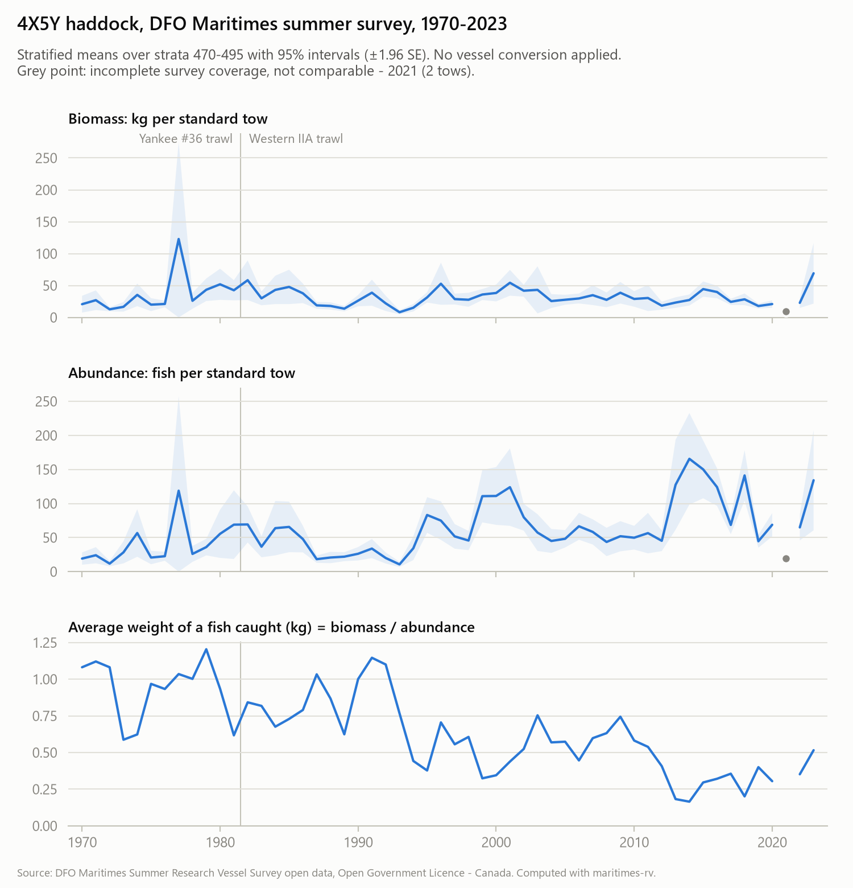

# maritimes-rv

A reproducible Python pipeline for the public release of the **DFO Maritimes summer research vessel (RV) bottom trawl survey**. The survey covers the Scotian Shelf and Bay of Fundy (NAFO 4VWX5Y), 1970–2023.

It turns the raw open-data files into:

1. **Clean, typed tables** (Parquet and CSV). Every quality problem is flagged rather than silently dropped.
2. **Stratified mean abundance and biomass indices** for 623 taxa, by region and year, with standard errors and coverage flags.
3. **Stratified mean summer bottom temperature** by region and year.

The method follows DFO's own R implementation and is validated against it and against published DFO indices (see [Validation](#validation)).

> This is an independent project. It is not produced, reviewed or endorsed by Fisheries and Oceans Canada.



## Quick start

Requires Python 3.12+ and [uv](https://docs.astral.sh/uv/).

To use the tables without running anything, download a ready-made release instead ([below](#ready-made-data)).

```bash
uv sync
uv run maritimes-rv fetch    # DFO open data -> data/raw     (CSV package + stratum areas)
uv run maritimes-rv clean    # data/raw      -> data/clean   (5 tables + manifest)
uv run maritimes-rv index    # data/clean    -> data/products (index, bottom_temp + manifest)
```

`fetch` downloads the survey's CSV package from open.canada.ca and the stratum areas from DFO's GIS service. The stratum areas are not in the CSV package.

Each `manifest.json` records the SHA-256 of the input files and the parameters used. DFO updates the dataset in place, so this ties every output to the exact data that produced it.

## Ready-made data

Each GitHub release of this repository includes `maritimes-rv-data-<date>.zip`. It contains:

- every cleaned table and product, as both Parquet and CSV;
- `data_dictionary.csv`, describing every column;
- a README with the caveats that matter for analysis;
- the manifests.

`SHA256SUMS` lets you verify the download. `sources.json` records which version of the DFO source data the release was built from.

```python
import pandas as pd
index = pd.read_parquet("maritimes-rv-data-2026-10-21/products/index.parquet")
haddock = index.query("species_code == 11 and region == '4X5Y' and complete")
```

R users can read the same files with `arrow::read_parquet()`. With DuckDB, the files can be queried directly in SQL.

## Automated updates

Two GitHub Actions workflows keep the data current and the code honest.

- **CI** (`.github/workflows/ci.yml`) runs on every push and pull request. It downloads the real data and runs the full test suite, including the regression test against the published DFO haddock index.
- **Data release** (`.github/workflows/data-release.yml`) runs on the 1st of each month:
  1. It downloads the DFO source data and fingerprints it (`maritimes-rv sources`).
  2. It compares the fingerprint with the one attached to the latest release.
  3. Only if the data changed does it rebuild everything, rerun the tests, and publish a new release (`maritimes-rv release`). It can also be run by hand, with an option to publish regardless.

  A source change the pipeline cannot handle stops the release instead of publishing wrong numbers. For example, a new vessel missing from the reference tables fails the integrity checks.

## Outputs

| Table | One row per | Key columns |
|---|---|---|
| `clean/missions` | survey trip | year, vessel_code, vessel_name |
| `clean/sets` | tow | start_datetime_local, stratum, position, distance_nmi, depth_m, bottom_temp_c, gear, `qc_*` flags |
| `clean/catch` | tow × species caught | weight_kg_std, count_std (per standard 1.75 nmi tow), `qc_weight_zero` |
| `clean/species` | species code | scientific_name, common_name, is_taxon |
| `clean/strata` | stratum | depth_min_fm, depth_max_fm, area_nmi2, area_km2, area_group |
| `products/index` | region × year × species | mean and SE per tow (count, kg), trawlable totals, n_strata_sampled, area_coverage, complete, gears, vessels |
| `products/bottom_temp` | region × year | mean_bottom_temp_c, se, n_sets_with_temp, complete |

Regions are `core` (strata 440–495), `4VW` (440–466) and `4X5Y` (470–495). These are the groupings DFO uses for stock assessments.

Column names carry their units (`distance_nmi`, `depth_min_fm`, `bottom_salinity_psu`). Two of the source's unit labels turned out to be wrong or missing.

## Method

For stratum *h* with area *A_h*, *n_h* tows, mean catch *ȳ_h* and standard error *se_h = s_h/√n_h*:

- **Stratified mean** = Σ A_h·ȳ_h / Σ A_h, over the strata sampled that year.
- **Standard error** = √(Σ A_h²·se_h²) / Σ A_h, over strata with n_h ≥ 2. Single-tow strata have no variance estimate. They are excluded and the weights renormalised, as in DFO's code.
- **Trawlable total** = Σ (A_h / swept area of a standard tow) · ȳ_h. A standard tow is 1.75 nmi × 41 ft (Western IIA trawl). This is a relative index, not stock size.

Further details:

- **Zero-filling.** Catches are zero-filled at analysis time: a species not recorded in a tow counts as 0.
- **Coverage.** A region-year is marked `complete` when the sampled strata cover at least 90% of its area. In this data, coverage is always either ≥ 99% or ≤ 55%.
- **Incomplete years.** These are flagged but not dropped. They are 2018, 2021 and 2022 for 4VW and core, and 2021 for 4X5Y. This matches how DFO treats them.
- **Vessel conversion.** Fanning's (1985) factors (haddock ×1.2; four flatfish ×0.8, for the A.T. Cameron and Lady Hammond) are available with `--convert`. They are off by default.

The formulas follow `stratify_simple()` and `calcYearSummary()` in DFO's [RVTransmogrifier](https://github.com/Maritimes/RVTransmogrifier). Deliberate differences from it:

| | RVTransmogrifier | maritimes-rv |
|---|---|---|
| Missing count or weight | treated as 0 | excluded from that metric and counted in `n_count_missing` (a species weighed but never counted, such as sponges, would otherwise get a count index of zeros) |
| Net width for totals | gear-specific (35 ft for the 1970s Yankee #36) | 41 ft for all years (Fanning 1985, Mar.stratisfy), so totals are a constant multiple of the per-tow index |
| Conversion factors | internal table converting to the newest vessels | public Fanning (1985) factors only, opt-in |

## Validation

Three independent checks, all reproducible:

1. **Hand-computed unit tests** (`tests/test_index.py`): every formula on a small example worked out in the comments.
2. **Line-by-line port of DFO's R code** (`validation/rvtransmogrifier_port.py`): a deliberately naive loop shares no code with the package. On 824 region-year-species rows without missing values, the mean and SE agree to 1e-15. Totals agree to 1e-6, because DFO rounds the nmi²→km² factor.
3. **Published DFO indices** (`validation/compare_published.py`, transcribed tables in `validation/published/`):

| Published source | Series | Agreement |
|---|---|---|
| Stone & Hansen 2015, Res. Doc. 2015/022, Table 9 | 4X5Y haddock total biomass, 1970–2014 | **45/45 years within 1%** (regression test) |
| Stobo et al. 1997, Res. Doc. 97/105 | 4X winter flounder, American plaice, yellowtail, per tow, 1970–97 | median ratio 0.997–1.000; differences concentrated in a few years, mostly in the 1970s |
| Trippel & Brown 1993/94, Res. Doc. 93/60, 94/67 | 4VWX pollock per tow, 1970–93 | 75% of years within 1% (published totals are sums over ages) |

From 1982 onward, the median difference from the published values is 0.07%.

## Issues found in the public data

Things you need to know before using these files, none of which are stated in the data dictionary:

- **Catches are already standardised** to a 1.75 nmi tow. For tows not exactly 1.75 nmi long, 96% of counts are fractional, and multiplying back by DIST/1.75 turns 99.9% of them into whole numbers. Standardising again, as DFO's own Mar.stratisfy does with raw data, double-counts the correction.
- **Comparative-fishing tows are mixed in.** The 1981 Lady Hammond and 2005 Teleost calibration tows re-fish the main vessel's stations, and there is no tow-type column to mark them. Including them makes 2005 4X5Y haddock 40% too high.
- **Stratum depths are in fathoms,** although the dictionary gives no unit. 98.9% of tows fall in their stratum's depth band when read as fathoms, against 22% as metres.
- **Zero means different things:**
  - `TOTNO = 0` means "not counted". It always comes with a weight, mostly for sponges, urchins and jellyfish.
  - `TOTWGT = 0` (8,861 rows, almost all before 2000) mostly means "too light to register". In the 1970s–80s, weights were recorded to the whole kilogram.
- **Weighing and distance precision changed over time.** Weights went from 1 kg (1970s–80s) to 0.1 g (2000s). The spread of tow speed in the 1970s is six times today's, because distance was recorded to 0.1 nmi.
- **Bottom temperature is missing** for 2021–2023 and almost all of 2005.
- **The length/age table (GSDET) is empty,** although the dataset description lists length frequencies.
- **The stratum areas are not in the CSV package,** only in the GIS service. That service lists most tows twice and records missing temperatures as 0 °C.
- **The dictionary gives salinity units as "pounds per square unit"** (it is PSU).

## Example analysis

[4X5Y haddock, 1970–2023](examples/haddock_4x5y.md) covers several results:

- the validation figure;
- why the average haddock caught now weighs about a third of what it did in the 1970s;
- how one 1977 tow makes up 63% of that year's index;
- the effect of the vessel conversion;
- a 1.4 °C rise in summer bottom temperature between 1970–99 and 2010–20.

## Status and roadmap

Done:

- Clean, typed tables, with quality flags and integrity checks
- Stratified abundance and biomass indices and bottom-temperature summaries, validated against DFO's code and published indices
- Example analysis (4X5Y haddock)
- `fetch` command, monthly update check and automated data releases

Planned:

- **A query layer**: a static web page to browse and download indices by species and region, or a small read-only API.
- **Bottom temperature merged from CTD profiles** (CIOOS Atlantic ERDDAP), to fill the years the survey tables lack (2005, 2021–2023).
- **WoRMS identifiers for species**, for interoperability with OBIS and FishGlob.

## Limitations

- **Design-based indices only.** They don't adjust for changes in distribution or catchability. Model-based indices are future work.
- **Core strata 440–495 only.** The CSV release does not include the newer Georges Bank (5Z) or deep Laurentian Channel strata.
- **No length or age data,** so no year-class or growth analysis.
- **Limited vessel conversion.** DFO's newer Teleost factors (Yin et al. 2025) are not applied; some are length-based and the factor table is not public.

## Related work

- **[RVTransmogrifier](https://github.com/Maritimes/RVTransmogrifier) and [Mar.stratisfy](https://github.com/Maritimes/Mar.stratisfy)** (DFO Maritimes, R). These are DFO's own tools, built for its internal database, and this project's reference implementation.
- **[DATRASextra](https://www.biorxiv.org/content/10.64898/2026.06.29.735240.full.pdf)** (R). ICES DATRAS trawl surveys.
- **[surveyjoin](https://peerj.com/articles/19964)** (R). Northeast Pacific surveys.

This project differs in being Python-based, depending only on the public open-data release, and documenting that release's pitfalls.

## Project layout

```
src/maritimes_rv/   fetch.py -> raw.py -> clean.py -> qc.py -> index.py -> release.py; pipeline.py and cli.py tie them together
  reference/        hand-curated tables (vessel names, conversion factors), each row with its source
tests/              unit tests and end-to-end tests on the real data (skipped if data/raw is absent)
validation/         DFO code port, published-index comparison, transcribed published tables
examples/           4X5Y haddock analysis, figures and the table behind them
docs/               data_notes.md (raw data issues in detail), data_model.md (tables, method, validation)
.github/workflows/  CI tests and the monthly data-release check
```

Run the tests with `uv run pytest`.

## Licence and attribution

The code is released under the [MIT License](LICENSE).

The survey data are not part of this repository and are not covered by that licence. They contain information licensed under the [Open Government Licence – Canada](https://open.canada.ca/en/open-government-licence-canada).

Source: Fisheries and Oceans Canada, *Maritimes Summer Research Vessel Survey*, [open.canada.ca dataset 1366e1f1-e2c8-4905-89ae-e10f1be0a164](https://open.canada.ca/data/en/dataset/1366e1f1-e2c8-4905-89ae-e10f1be0a164).
