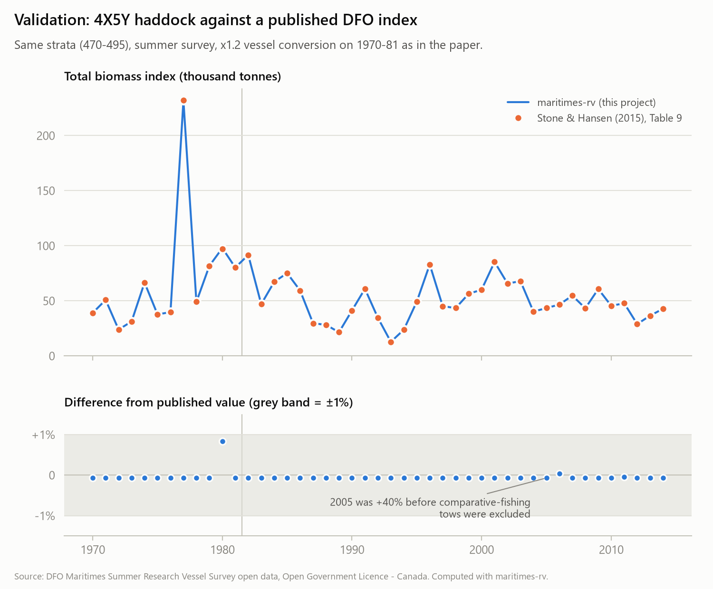
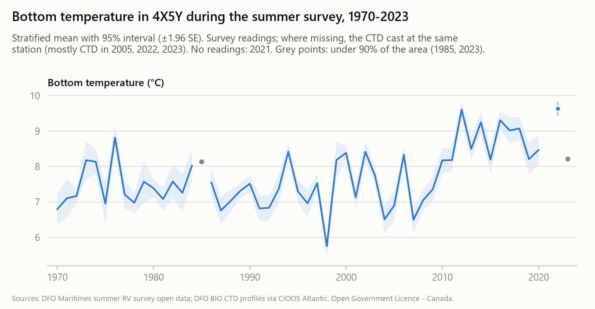

# Example: 4X5Y haddock, 1970–2023

Haddock in NAFO divisions 4X5Y (western Scotian Shelf and Bay of Fundy, survey strata 470–495) is one of the stocks the DFO Maritimes summer survey is used to assess. This example uses `maritimes-rv` to answer two questions:

1. Can a pipeline built only from the public data reproduce DFO's published survey index?
2. What do the survey indices show for this stock over 54 years?

Every number below is printed by [`haddock_4x5y.py`](haddock_4x5y.py), and the table behind the figures is [`figures/haddock_4x5y.csv`](figures/haddock_4x5y.csv). Numbers can shift slightly as DFO updates its data; this text reflects the data of October 2026.

```bash
uv run maritimes-rv clean
uv run maritimes-rv index
uv run --group examples python examples/haddock_4x5y.py
```

## 1. The public data reproduces the published index



Stone & Hansen (2015, CSAS Res. Doc. 2015/022, Table 9) publish the summer survey total biomass index for 4X5Y haddock for 1970–2014. That index applies a ×1.2 vessel conversion to 1970–81. Applying the same conversion here, **all 45 years agree within 1%**. The largest difference is 0.84%, in 1980.

The comparison also exposed a problem in the public data. The first run was 40% too high in 2005. The open data includes nine tows from the 2005 Needler–Teleost comparative fishing experiment. In that experiment the Teleost returned to stations the Needler had already fished, so counting those tows double-counts the stations. The public tables have no tow-type column to mark them. The pipeline now detects such tows (`qc_comparative_fishing`) and leaves them out of the index. The same rule found the 1981 Lady Hammond calibration tows.

## 2. More fish, smaller fish


The biomass index has no long-term trend: decade means range from 28 to 38 kg per standard tow. The lowest year is 1993, at 8.1 kg per tow.

The number of fish caught per tow, by contrast, has risen steadily:

| | 1970s | 1980s | 1990s | 2000s | 2010s |
|---|---|---|---|---|---|
| Fish per tow | 36 | 47 | 49 | 69 | 97 |
| kg per tow | 34.6 | 36.2 | 28.7 | 36.2 | 28.3 |
| Average kg per fish | 0.96 | 0.79 | 0.70 | 0.56 | 0.34 |

Biomass is roughly constant while numbers are up, so the average haddock caught is now about a third of its 1970s weight. In 2014, the year of the highest catch per tow (166 fish), it was 0.16 kg.

The survey totals cannot tell us why. Two explanations fit, and they are not mutually exclusive:

- **More young fish:** strong recruitment adds many small fish.
- **Slower growth:** fish are smaller at a given age.

Separating them needs length and age data. DFO collects these, but the public release's length/age table (GSDET) is empty.

Average weight here is a ratio of two stratified means, not an average of per-tow ratios, so it weights each stratum by area like the indices themselves.

## 3. One tow can be most of a year

The highest biomass index in the series is 1977, at 122.9 kg per tow. But one tow, ATC1977265 set 42, caught 1,939 kg of haddock. On its own, that tow makes up **63% of the 1977 stratified mean**. The coefficient of variation that year is also 63%, and the 95% interval runs from zero to about 275 kg per tow.

Haddock school, and a design-based stratified mean has no protection against the occasional very large catch. 1977 should not be read as the stock tripling. This sensitivity is one reason stock assessments increasingly use model-based indices. A model-based index for this data is listed as future work.

## 4. The vessel conversion shifts a whole era

Without conversion, 1970–81 averages 36.7 kg per tow. With Fanning's (1985) ×1.2 haddock factor it averages 44.0. That is a 20% step for the entire pre-1982 period, compared with everything after.

The indices are produced without conversion by default. `maritimes-rv index --convert` applies the factors DFO's own code uses. Either way, the `vessels` and `gears` columns show which era a year belongs to, and the trend figure marks the 1981/82 gear change.

## 5. Bottom temperature



Each tow's reading is the survey's own where it has one. The survey tables have no bottom temperatures for 2021–2023 and almost none for 2005. Where a tow has no reading, it takes the reading of the CTD cast made at the same station. These casts come from DFO's survey CTD profiles on CIOOS Atlantic, matched to the tow by id, or by a cast within 2 km and 2 hours of the tow's end. Where both sources exist, they agree within 0.1 °C for 99% of tows. This fills 2005, 2022 and most of 2023.

Over the 51 years with full coverage (1970–2022):

- The mean summer bottom temperature in 4X5Y was **7.36 °C for 1970–1999 and 8.80 °C for 2010–2022**, a rise of about 1.4 °C.
- The linear trend over the whole period is +0.28 °C per decade.
- The warmest years are 2022 (9.63 °C, all from CTD casts) and 2012 (9.61 °C). Their intervals overlap, so they are effectively tied. 2012 coincides with the widely reported 2012 marine heatwave in the Northwest Atlantic.

The remaining gaps:

- **2021:** no readings. The open trawl data has only two tows that year, and neither has a matching cast.
- **2023:** readings cover 88% of the area, so the year is marked incomplete.
- **1985:** readings cover only 75% of the area.

This example does not test whether warming is related to the change in haddock size.

## What this example does not show

- **The index is relative.** Totals assume the net catches every fish in its path, which it does not. They track change over time but are not estimates of the stock size.
- **No length or age data**, so no year-class or growth analysis.
- **Recent years are less comparable.** 2021 had only two tows in 4X5Y. 2022 and 2023 were surveyed by the Teleost (as were 2004, 2007 and 2018), and no Teleost conversion is applied.
- **Only Fanning's 1985 factors are available.** DFO's newer factors are length-based and their table is not public.
